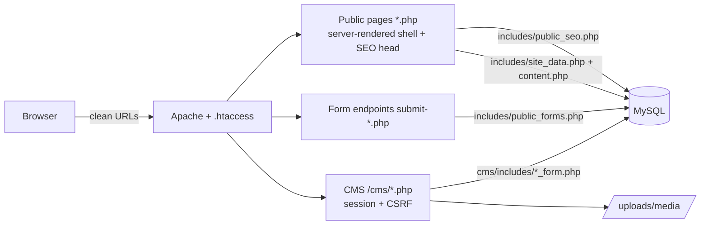
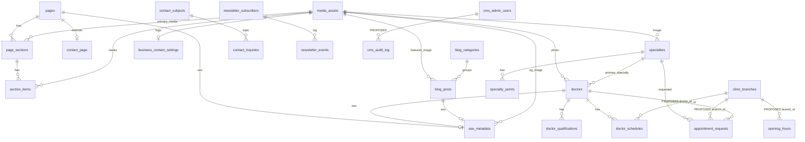

# NMC Clinic — Architecture & Design

Status: analysis of `main` @ `fcd3af4` (2026-11-26) plus proposed design changes.
Knowledge graph: `graphify-out/graph.html`, `graphify-out/GRAPH_REPORT.md` (488 nodes, 709 edges).

---

## 1. System overview

Plain PHP 8.2 + MySQL 8.4 site. No framework, no build step, no Composer/npm.



| Layer | Files | Role |
|---|---|---|
| Routing | `.htaccess` | Clean URLs (`/about`, `/blog/{slug}`), 301 from `*.html/*.php`, blocks `*.sql *.zip *.md`, `migrations/`, `plan/`, dotfiles, 404 fallback |
| DB access | `cms/config/database.php` | `db()` singleton PDO, reads `.env` / env vars, `ERRMODE_EXCEPTION`, native prepares. Most-connected node in the graph (54 edges) |
| Public pages | `index.php about.php specialties.php doctors.php blog.php blog-detail.php contact.php 404.php` | Server-rendered from `includes/site_data.php` (published rows) and `includes/content.php` (CMS-editable copy, `includes/content_registry.php`) + `public_render_page_head()` (SEO meta, JSON-LD `MedicalClinic`) |
| Public forms | `submit-appointment.php submit-contact.php` + `includes/public_forms.php` | Validate, session rate limit, consent, IP hash, insert |
| SEO | `includes/public_seo.php robots.php sitemap.php` | Meta, canonical, OG, schema, sitemap from DB |
| CMS | `cms/*.php`, `cms/includes/*` | Admin CRUD: doctors, specialties, blog, categories, branches, media, SEO, contact, settings, submissions |
| Deploy | `Dockerfile docker-compose.yml .env.example DOCKER.md` | `php:8.2-apache` + `mysql:8.4` + phpMyAdmin (127.0.0.1 only); `db.sql` runs on empty volume |

---

## 2. Frontend design

### 2.1 Rendering model
Server-rendered: each page renders its lists (from `includes/site_data.php`) and its copy (from `page_content()`, editable in CMS > Content, registry defaults as fallback) in PHP. `assets/script.js` only adds behaviour (menu, filters, form submit, branch picker, open status, reveal, year); it fetches no content.


### 2.2 JS markup contracts (`assets/script.js`)
- `[data-filter-group] / [data-filter-target] / [data-category]` — tab filters.
- `form[data-success]` — AJAX submit to `action`, JSON `{ok, message}`.
- `[data-branch-picker]` with `[data-branch-list] iframe[data-branch-map] [data-branch-directions]` — branch map.
- `[data-open-status][data-hours]` (hours JSON from Settings) and `[data-year]`.
- `[data-reveal]` — staggered fade-in, skipped under `prefers-reduced-motion`.

### 2.3 Design tokens (`assets/style.css :root`)
Teal brand scale `--teal-900…025`, accent `--yellow`, ink `--ink/--ink-2/--muted`, ground `--paper`.
Radius rule: chips 6, controls 10, cards 12, media 16. Font: Hanken Grotesk (Google Fonts).
No Tailwind, no component library, no `DESIGN.md`.

### 2.4 Frontend recommendations
1. Server-render the list pages (doctors, specialties, blog index) the way `blog-detail.php` already does. Today crawlers see fallback/placeholder content; JS swaps it later. Keep `script.js` for filters only.
2. `support.js` (66 KB, generated "dc-runtime") is not referenced anywhere. Delete it.
3. Newsletter form in `blog.php` has no `action` and no backend. Add `submit-newsletter.php` (see §3.3) or remove the form.
4. `NMCclinic.zip` (13 MB) sits in the web root. It is blocked by `.htaccess` and `.dockerignore`. The two `pasted-*` screenshots were removed from the repo; `.htaccess` and `.dockerignore` also keep dev output (`graphify-out`, `.superpowers`, `.playwright-cli`, `tests`, `docs`) out of the web root and the image.

---

## 3. Backend design

### 3.1 Conventions (keep these)
- One PHP file per endpoint/page; shared logic in `includes/` (public) and `cms/includes/` (admin).
- All SQL through `db()` with prepared statements.
- Output escaping: `e()` (CMS), `public_e()` (public).
- CMS writes: `require_admin()` + `csrf_is_valid()`.
- Soft delete via `deleted_at`; public queries filter `deleted_at IS NULL AND status='published' AND is_visible=1`.

### 3.2 Endpoints

| Method | Path | Auth | Tables |
|---|---|---|---|
| POST | `/submit-appointment.php` | public, rate-limited | appointment_requests |
| POST | `/submit-contact.php` | public, rate-limited | contact_inquiries |
| GET | `/sitemap.xml`, `/robots.txt` | public | pages, doctors, blog_posts, seo_metadata |
| GET/POST | `/cms/login.php` | — | cms_admin_users |
| GET/POST | `/cms/*` | session + CSRF | all |

### 3.3 Backend recommendations
1. **Newsletter**: `submit-newsletter.php` reusing `includes/public_forms.php` (`form_rate_limit('newsletter')`, `filter_var(FILTER_VALIDATE_EMAIL)`, `INSERT … ON DUPLICATE KEY UPDATE`), plus a `newsletter_events` row (`subscribed`).
2. **Login throttling**: `cms/login.php` has none. Add `cms_login_attempts` (§4.3) and block after 5 failures / 15 min per email + IP hash.
3. **Rate limit**: `form_rate_limit()` is session-based; a client that drops the cookie bypasses it. Add a DB check on `ip_hash` + `created_at` (last 30 s) in the same insert path.
4. **Notifications**: `contact_subjects.recipient_email` exists but nothing sends mail. Add mail on new inquiry/appointment when the clinic confirms an SMTP provider.
5. **Seed admin**: `db.sql` seeds `admin@nmcclinic.com / admin123`. Change the password on first deploy; better, seed with `status='disabled'` and create the real admin by CLI.

---

## 4. Database schema

### 4.1 Current tables (23, InnoDB, utf8mb4)

| Group | Tables | Used by code |
|---|---|---|
| CMS core | `pages`, `page_sections`, `section_items`, `media_assets`, `cms_admin_users`, `seo_metadata` | `page_sections`, `section_items` **unused** |
| Business | `business_contact_settings`, `opening_hours`, `social_links`, `clinic_branches` | yes |
| Contact | `contact_page`, `contact_subjects`, `contact_inquiries` | yes |
| Clinical | `specialties`, `specialty_points`, `doctors`, `doctor_qualifications`, `doctor_schedules` | yes |
| Blog | `blog_categories`, `blog_posts` | yes |
| Leads | `appointment_requests`, `newsletter_subscribers`, `newsletter_events` | newsletter **write path missing**, `newsletter_events` **unused** |

### 4.2 ER diagram (current + proposed in dashed notes)



### 4.3 Proposed schema changes

Ordered by value. Each item is independent. None is applied yet — ship as `migrations/<date>-*.sql` **and** mirror into `db.sql` (Docker only runs `db.sql` on an empty volume).

**A. Link branches to schedules, hours and appointments.** Two branches exist (Butwal, Bhairahawa), but `doctor_schedules.location_label` is free text, `opening_hours` is global, and appointments do not record a branch.

```sql
ALTER TABLE doctor_schedules
  ADD COLUMN branch_id BIGINT UNSIGNED NULL AFTER doctor_id,
  ADD KEY idx_doctor_schedules_branch (branch_id),
  ADD CONSTRAINT fk_doctor_schedules_branch FOREIGN KEY (branch_id) REFERENCES clinic_branches(id) ON DELETE SET NULL;

ALTER TABLE appointment_requests
  ADD COLUMN branch_id BIGINT UNSIGNED NULL AFTER specialty_id,
  ADD COLUMN doctor_id BIGINT UNSIGNED NULL AFTER branch_id,
  ADD KEY idx_appointment_requests_branch (branch_id),
  ADD KEY idx_appointment_requests_doctor (doctor_id),
  ADD CONSTRAINT fk_appointment_requests_branch FOREIGN KEY (branch_id) REFERENCES clinic_branches(id) ON DELETE SET NULL,
  ADD CONSTRAINT fk_appointment_requests_doctor FOREIGN KEY (doctor_id) REFERENCES doctors(id) ON DELETE SET NULL;

-- NULL branch_id = clinic-wide default row.
ALTER TABLE opening_hours
  ADD COLUMN branch_id BIGINT UNSIGNED NULL AFTER id,
  DROP INDEX uq_opening_hours_day,
  ADD UNIQUE KEY uq_opening_hours_branch_day (branch_id, day_of_week),
  ADD CONSTRAINT fk_opening_hours_branch FOREIGN KEY (branch_id) REFERENCES clinic_branches(id) ON DELETE CASCADE;
```
Note: MySQL treats NULLs as distinct in a UNIQUE key, so the clinic-wide rows (`branch_id IS NULL`) lose the one-row-per-day guarantee. Enforce it in `cms/settings.php` save logic.

**B. CMS login throttling.**
```sql
CREATE TABLE cms_login_attempts (
  id BIGINT UNSIGNED AUTO_INCREMENT PRIMARY KEY,
  email VARCHAR(191) NOT NULL,
  ip_hash CHAR(64) NULL,
  succeeded TINYINT(1) NOT NULL DEFAULT 0,
  created_at DATETIME NOT NULL DEFAULT CURRENT_TIMESTAMP,
  KEY idx_login_attempts_email_time (email, created_at),
  KEY idx_login_attempts_ip_time (ip_hash, created_at)
) ENGINE=InnoDB DEFAULT CHARSET=utf8mb4 COLLATE=utf8mb4_unicode_ci;
```

**C. Audit log** (requested in the `plan/*.txt` docs; medical-content review needs a trail).
```sql
CREATE TABLE cms_audit_log (
  id BIGINT UNSIGNED AUTO_INCREMENT PRIMARY KEY,
  admin_id BIGINT UNSIGNED NULL,
  entity_type VARCHAR(50) NOT NULL,   -- 'doctor','blog_post','settings',...
  entity_id BIGINT UNSIGNED NULL,
  action ENUM('create','update','delete','publish','login') NOT NULL,
  changes_json JSON NULL,
  created_at DATETIME NOT NULL DEFAULT CURRENT_TIMESTAMP,
  KEY idx_audit_entity (entity_type, entity_id, created_at),
  KEY idx_audit_admin (admin_id, created_at),
  CONSTRAINT fk_audit_admin FOREIGN KEY (admin_id) REFERENCES cms_admin_users(id) ON DELETE SET NULL
) ENGINE=InnoDB DEFAULT CHARSET=utf8mb4 COLLATE=utf8mb4_unicode_ci;
```

**D. Fix seeded canonical URLs.** `db.sql` seeds `http://localhost/NMCclinic/*.html`, which conflicts with the clean URLs in `.htaccess`. Seed `canonical_url = NULL` and let `public_seo.php` derive it from `SITE_URL`.
```sql
UPDATE seo_metadata SET canonical_url = NULL WHERE canonical_url LIKE 'http://localhost/%';
```

**E. Decide on unused tables.**
- `page_sections` / `section_items`: page copy is hard-coded in PHP. Either build a CMS "Page content" editor on them, or drop them. Recommendation: keep until the client confirms whether they will edit homepage/about copy (see `CLIENT_DATA_CHECKLIST.md`).
- `newsletter_events`: keep; it gets used once §3.3-1 ships.

**F. Only if the client needs it** (raised in plan docs, marked AMBIGUOUS in the graph):
- `doctor_specialties (doctor_id, specialty_id, is_primary)` many-to-many, if a doctor covers more than one specialty.
- `blog_authors` table linked to `doctors`, if articles must show a verified doctor byline instead of free-text `author_name`/`reviewer_name`.
- `blog_tags` / `blog_post_tags`, `page_revisions`.

---

## 5. Security notes (from this analysis)

Checked: SQL (all prepared), XSS (escaped output; blog body stored as escaped `<p>` HTML), CSRF (CMS), sessions (`httponly`, `samesite=Lax`, `secure` behind HTTPS, ID regenerated on login), uploads (2 MB, `finfo` MIME allow-list jpg/png/webp, `getimagesize`, random filename), secrets (`.env` gitignored, compose requires passwords), exposure (`.htaccess` blocks dumps/plans/dotfiles; phpMyAdmin bound to 127.0.0.1).

Findings:
1. **High** — default admin `admin123` seeded by `db.sql`. Change before any public deploy.
2. **Medium** — no CMS login brute-force protection (§4.3-B).
3. **Low** — public form rate limit is per-session only (§3.3-3).
4. **Low** — `NMCclinic.zip` (full site copy) is committed to git. It is excluded from the Docker image and blocked by `.htaccess`, but under XAMPP it sits in the web root. Remove it from the repo.
